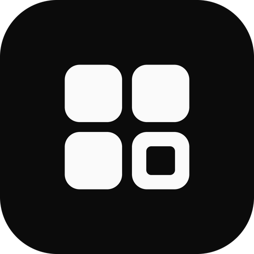
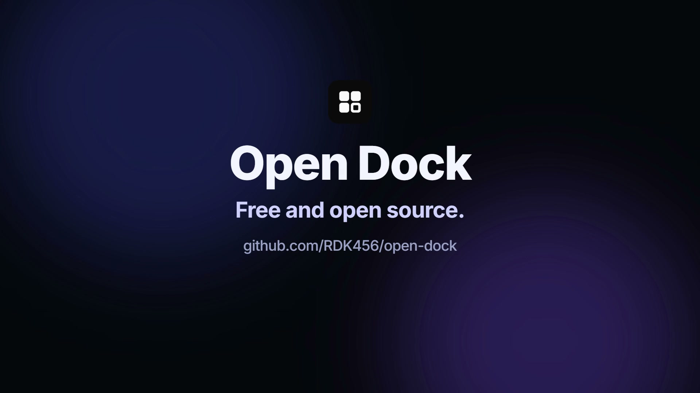
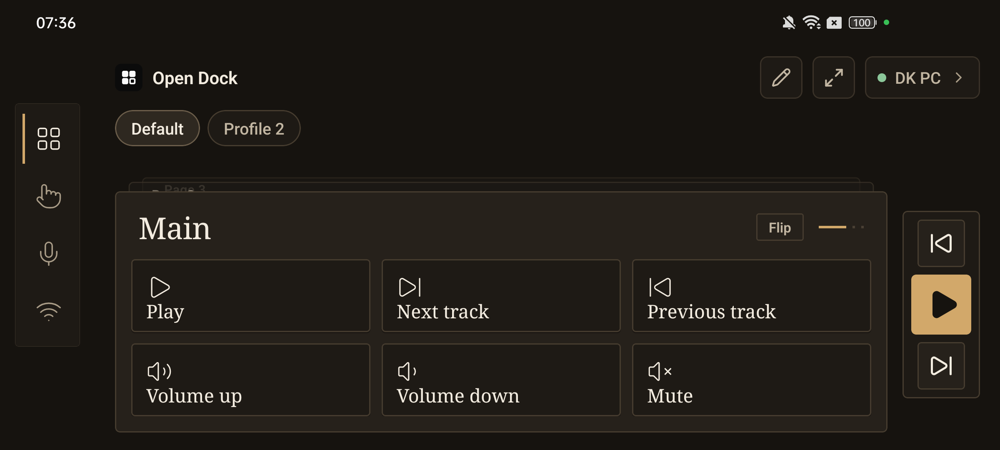
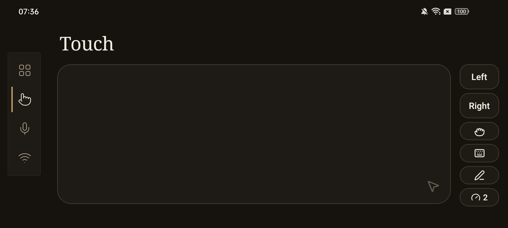
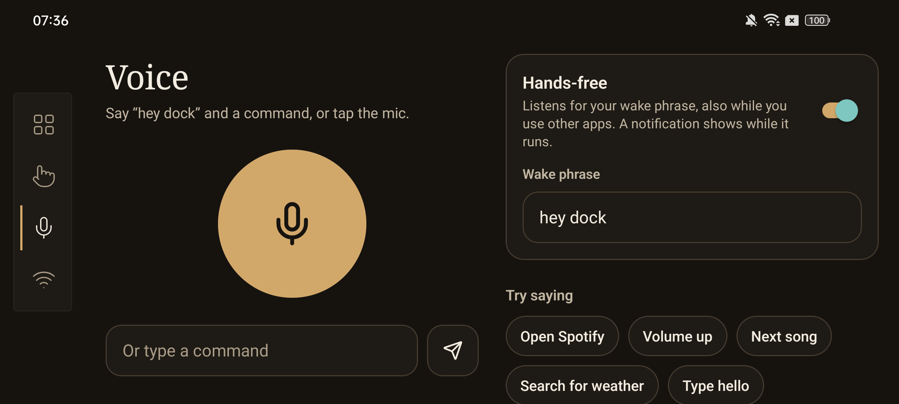
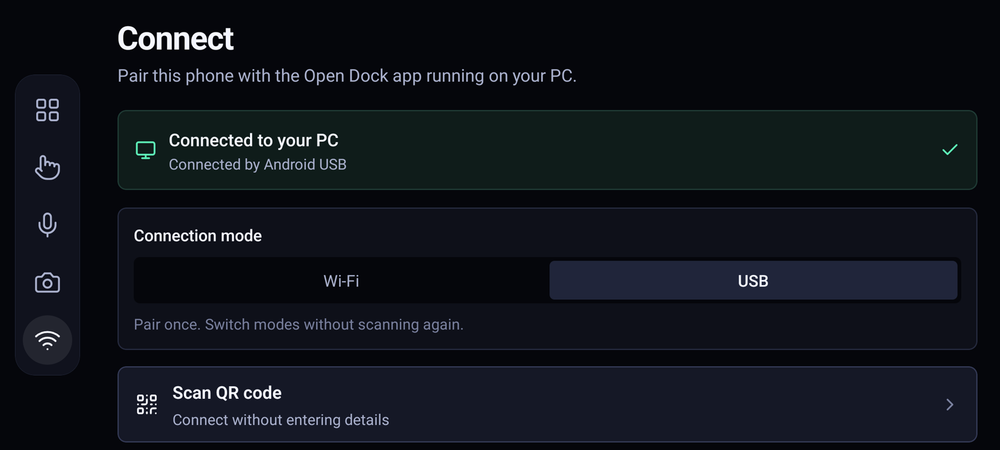

<p align="center"></p>

# Open Dock

Turn your phone into a PC dock: media keys, hotkeys, app launchers, live PC stats, voice commands, a touchpad, a webcam and a desktop pet. Free and open source. Works over Wi-Fi, or USB on Android.

<a href="docs/media/brag.mp4"></a>

<p align="center">
  
  
  
  
</p>

## Install

Download from the [latest release](https://github.com/RDK456/open-dock/releases/latest). After the first install, Open Dock updates itself.

| Platform | File | First-run note |
|---|---|---|
| Windows | `Open Dock_*_x64-setup.exe` | "Windows protected your PC": choose **More info → Run anyway** (installer is unsigned). |
| macOS | `Open Dock_*_aarch64.dmg` (Apple silicon) or `_x64.dmg` (Intel) | Not notarized: **System Settings → Privacy & Security → Open Anyway**. Also allow Open Dock under **Accessibility** so it can send media keys. |
| Android | `OpenDock.apk` | Allow installs from your browser or file manager. |

iOS runs from source with Expo Go (Wi-Fi only).

## Get started

1. Open **Open Dock** on your PC. It shows a pairing QR code.
2. Put the phone on the same Wi-Fi network.
3. On the phone, open the **Connect** tab and scan the QR code. Pairing is saved; next time it reconnects on its own.

**USB (Android):** enable USB debugging, plug in the phone, pick **Android USB → Set up USB** in the PC app. Afterwards switch between Wi-Fi and USB from **Connect**.

## How to use it

The side bar switches between five tabs: **Deck**, **Touch**, **Voice**, **Camera**, **Connect**.

### Deck

| Gesture | What it does |
|---|---|
| Tap a key | Runs it: media key, shortcut, app launch or a sequence of shortcuts. |
| Long-press a key | Runs its secondary action, if one is set. |
| Swipe left / right *(full screen)* | Previous / next page. |
| Swipe up / down *(full screen)* | Next / previous profile. |
| Drag a slider or scrub bar | Volume, seek and similar widgets follow your finger. |
| ✏️ Edit | Tap a key to change it, **+** to add one, long-press to pin it to the side rail. |
| ⤢ Expand | Full-screen deck, no tab bar. |

Tap the PC name (top right) to switch between paired PCs.

### Touch (touchpad)

| Gesture | What it does |
|---|---|
| One finger | Move the cursor. |
| Tap | Left click. |
| Two-finger tap | Right click. |
| Two fingers, same direction | Scroll. |
| Pinch | Zoom. |
| ✊ button | Hold left button to drag; tap again to release. |
| ⌨ button | Type on the PC from the phone keyboard. |
| Speed button | Cycle pointer speed. |

### Voice

Tap the mic and say a command, or turn on hands-free and say your wake phrase (works while you use other apps).

### Camera

Use the phone as a webcam: start it on the **Camera** tab, then open the Camera section in the PC app. Switch front/back, torch, stabilise and zoom from the phone.

### Pet

A desktop pet widget that plays games, wears outfits and reacts to your music.

## Build from source

```bash
# PC app (Windows or macOS; macOS needs Xcode Command Line Tools)
cd pc-companion && npm install && npm run tauri dev

# Phone app
cd phone-app && npm install && npm start
```

The PC app listens on port `39421`. Protocol details: [pc-companion/README.md](pc-companion/README.md).

## License

[GPL-3.0](LICENSE). `phone-app/` includes MIT-licensed Expo template files; macOS builds bundle [mediaremote-adapter](https://github.com/ungive/mediaremote-adapter) (BSD-3-Clause); picker icons come from the [Papirus theme](https://github.com/PapirusDevelopmentTeam/papirus-icon-theme) (GPL-3.0).
